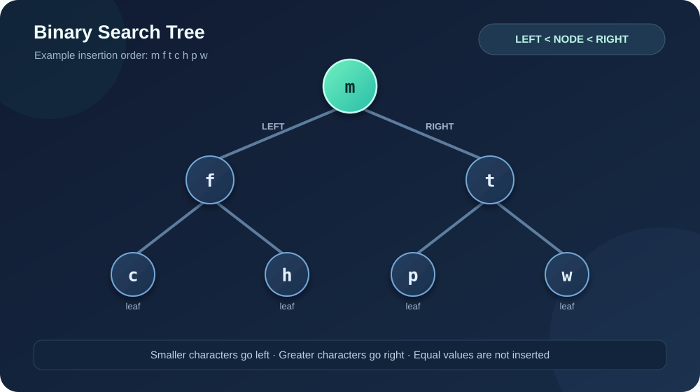
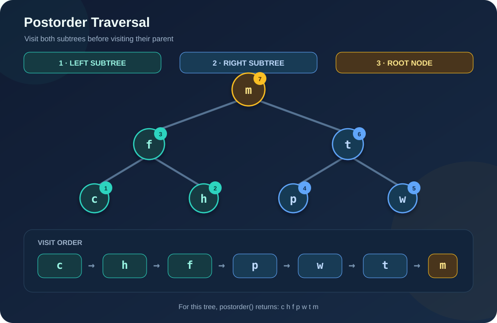

# 🌳 Binary Search Tree with Windows Forms (C++/CLI)

<p align="center">
  
  
  
  
  
</p>

---

## 📖 Project Overview

This project is an interactive **Binary Search Tree (BST)** implementation using **C++/CLI and Windows Forms**. It allows users to build a tree from a sequence of unique characters and explore its structure and traversal results through a graphical interface.

Each character is converted to lowercase before insertion. Smaller characters are placed in the left subtree, while greater characters are placed in the right subtree. The application also provides several tree queries, including searching for a character, displaying its parent and descendants, and finding the second consonant encountered during a postorder traversal.

---

## ✨ Features

- 🌱 **Create a BST** from a space-separated sequence of single ASCII characters.
- 🔎 **Search for a character** in the tree (case-insensitive).
- 🔄 **Postorder traversal** using the `Left → Right → Root` order.
- 🌿 **Inspect the root and subtrees**, with the left and right subtrees displayed in postorder.
- 👪 **Find a node's parent and descendants**; descendants are listed in preorder, excluding the selected node itself.
- 🔤 **Find the second consonant** encountered during postorder traversal, using the consonant list defined in `BinaryTreeSearch.h`.
- ⚠️ **Input validation** for empty input, non-ASCII characters, repeated characters in the entered sequence, and characters that already exist in the tree.

---

## 🌲 Binary Search Tree Visualization

The following example is built by inserting `m f t c h p w` in that order. The diagram shows the BST property: values smaller than a node go to the left, and values greater than a node go to the right.

<p align="center">
  
</p>

---

## 🔁 Postorder Traversal Visualization

Postorder traversal visits the **left subtree first**, then the **right subtree**, and finally the current node. For the example tree above, the result is:

`c h f p w t m`

<p align="center">
  
</p>

The `postorder()` method implements this order recursively:

1. Traverse the left subtree.
2. Traverse the right subtree.
3. Append the current node's value.

> **Note:** Postorder is not the same as preorder. Preorder visits `Root → Left → Right`; this project’s **Postorder** operation visits `Left → Right → Root`.

---

## 🕹️ How to Use the Application

### 1️⃣ Create the Tree

Enter unique characters separated by spaces. For example:

```text
m f t c h p w
```

Click **Create Tree**. The application inserts each character into the BST and displays the root along with the postorder traversal of the left and right subtrees.

### 2️⃣ Display Postorder Traversal

Click **Зворотний обхід** (*Postorder Traversal*) to display the complete tree traversal in `Left → Right → Root` order.

### 3️⃣ Find a Character

Enter one character and click **Знайди елемент в дереві** (*Find Element*) to check whether it exists in the tree.

### 4️⃣ Find the Parent and Descendants

Enter a character and click **Знайти батька і нащадка елемента**. The result includes its parent (or identifies it as the root) and its descendants in preorder.

### 5️⃣ Find the Second Consonant

Click **Знайти 2 приголосну** to search for the second consonant in postorder traversal. The consonants are defined explicitly in `BinaryTreeSearch.h`.

---

## 🧠 Implementation Details

- **Insertion:** recursive comparison places each value in the left or right subtree.
- **Search:** follows BST comparisons, avoiding a full traversal when the tree is properly constructed.
- **Postorder:** recursively processes left, right, then current node.
- **Parent lookup:** follows the same comparison path from the root.
- **Duplicate handling:** the GUI checks for duplicates both within the current input and against values already in the tree.
- **Character handling:** input is converted to lowercase; the GUI accepts single ASCII characters separated by spaces.

The tree is **not self-balancing**, so its shape depends on insertion order. In the current GUI, creating another sequence adds values to the existing tree; there is no clear/reset button.

---

## 🛠️ Tech Stack

- **Language:** C++ / C++/CLI
- **GUI Framework:** Windows Forms
- **IDE:** Visual Studio with C++/CLI support
- **Core Concepts:** Binary Search Trees, recursion, tree traversal, dynamic memory, character comparison

---

## 📂 Key Project Files

- `BinaryTreeSearch.h` — BST node definition and core operations: insertion, search, postorder traversal, parent/descendant lookup, and second-consonant search.
- `MyForm.h` — Windows Forms interface, input validation, button handlers, and display of tree information.
- `MyForm.cpp` — Application entry point and main form startup.
- `assets/binary-search-tree.svg` — SVG illustration of the BST structure.
- `assets/postorder-traversal.svg` — SVG illustration of the postorder visit sequence.

---

## 🚀 How to Run

1. Clone your repository:

   ```bash
   git clone https://github.com/XkrasherX/BinaryTreeSearchWinForm.git
   ```

2. Open the solution (`.sln`) in **Visual Studio** on Windows.
3. Make sure the project is configured for **C++/CLI and Windows Forms**.
4. Build and run the application.
5. Enter a sequence of unique characters, then use the buttons to explore the tree.

---

## 👤 Author

**XkrasherX**

<p>
  <a href="https://github.com/XkrasherX">
    
  </a>
</p>

---

<p align="center">
  ✨ <i>If this project helped you learn about binary search trees and traversal algorithms, feel free to give it a star!</i> ✨
</p>
